# Канон TaskFlow (срез 10.11.2026)

**Зачем:** один документ «как система устроена сейчас», чтобы резать сервер и iOS
по живому контуру, а не по Todoist-1.0. Резать код в этом документе не надо —
сначала канон. Когда срезка начнётся: **не удалять навсегда**, а откладывать
(архив / ветка / папка), чтобы при ошибке можно было вернуть и приконнектить.

**Источники (по убыванию силы):**

1. `INDEX.md` — решения владельца (особенно 05.11.2026).
2. `docs/current/*` и датированные `docs/2026-10*`, `docs/2026-11*`.
3. Нативный клиент на Mac: `/Users/max/Проекты/TaskFlowNativeBuild`
   (`Sources/Features/*`, `graft/*`) — живая карта экранов и механик.
4. Код сервера + `graft/` в этом репо — привязка слоя к модулям.

При конфликте дат: INDEX 05.11 > docs/2026-11-08* (чаты) >
`taskflow-flow.md` (срез 05.10) > graft-саммари.

**Не канон:** Inbox / Today / Labels как продукт; замороженный веб-клиент;
старая таблица `task_role_slots`; dual-path «одиночный запуск мимо плана».

---

## 0. Два контура: сервер и iPhone

| Контур | Где                                         | Роль в каноне                                                                             |
| ------ | ------------------------------------------- | ----------------------------------------------------------------------------------------- |
| Сервер | `server/` на `.110`, этот репозиторий       | Истина исполнения, планов, слотов, коммуникации, merge                                    |
| iPhone | `TaskFlowNativeBuild` на Mac                | Единственный живой UI владельца; экраны показывают, какие механики сервера реально в ходу |
| Веб    | `src (Временно приостановлена разработка)/` | Заморожен 24.10 — не ориентир продукта                                                    |

На iPhone слои канона видны так (ориентиры для срезки клиента тоже):

| Слой канона                     | Где в iOS (ориентир)                                                                                                     |
| ------------------------------- | ------------------------------------------------------------------------------------------------------------------------ |
| Spine / карточка / план / слоты | `Features/Tasks` (+ `Detail`), graft `task-detail-collaboration-ui`, `collaboration-planning-execution-graph`            |
| Mission Control                 | `Features/Missions`, `MissionControlScreen`, graft `overview-missions`, `mission-contract-assertions`                    |
| Шаблоны плана                   | модели `CollaborationPlanTemplate` в graft `collaboration-planning-execution-graph`                                      |
| Координация / граф              | `Features/Coordination`, graft `coordination-workflow-engine`                                                            |
| Чаты on/off card                | `Sources/Chat`, `TaskChatSheet`, graft `role-chat-system`, `task-chat-collaboration-interface`, `chat-work-plan-display` |
| Роли / окружение                | `Features/Roles`                                                                                                         |
| Рутины (шаблоны по расписанию)  | `Features/Routines`                                                                                                      |

`Features/Inbox`, `Planner` (today/upcoming), `Projects` — наследие навигации;
не считать их ядром продукта при срезке, пока владелец не скажет иное.

### Атлас экранов (iOS, 10.11.2026)

Оригинал на Mac: `TaskFlowNativeBuild/docs/canon-shots-2026-11-10/` (в git не
лежит). В этом репо смотреть `./canon-shots/`. PNG **не коммитить**, пока
владелец не скажет иначе. Ссылок на GitHub нет — только локальные пути.

| Кадр | Файл | Экран |
| ---- | ---- | ----- |
| 01 | `01-overview.png` | Обзор |
| 02 | `02-alltasks.png` | Все задачи |
| 03 | `03-task-detail.png` | Карточка (spine); task `f9c48548-b3eb-46d7-9291-d519b6e72e84` |
| 04 | `04-chat.png` | Чат |
| 05 | `05-rolechat.png` | Чат роли |
| 06 | `06-agents.png` | Агенты / роли |
| 07 | `07-roleload.png` | Нагрузка ролей |
| 08 | `08-projects.png` | Проекты (наследие навигации, не ядро) |
| 09 | `09-settings.png` | Настройки |
| 10 | `10-notes.png` | Заметки |
| 11 | `11-mission-control.png` | Mission Control |
| 12 | `12-coordination.png` | Координация |

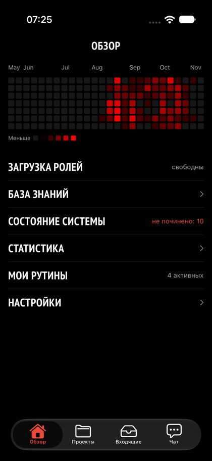


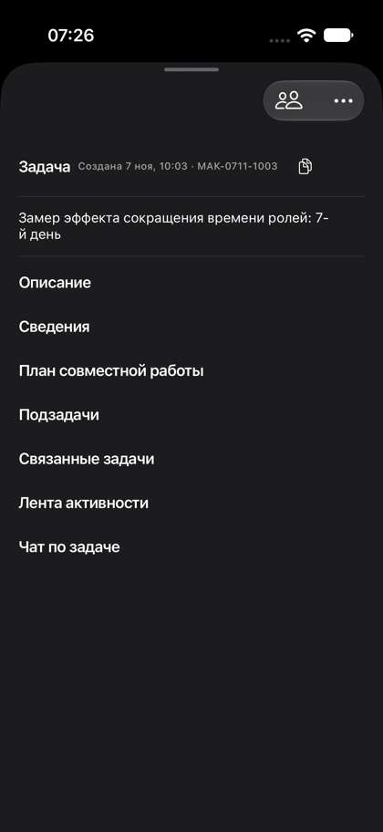

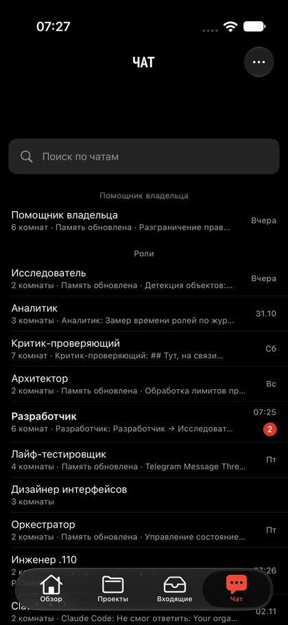

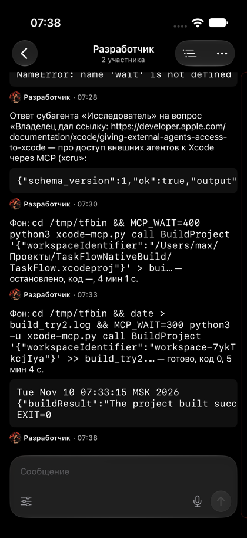

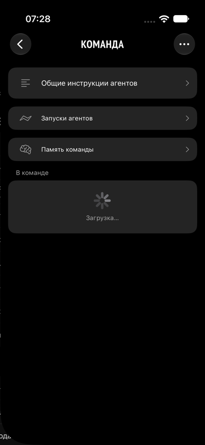

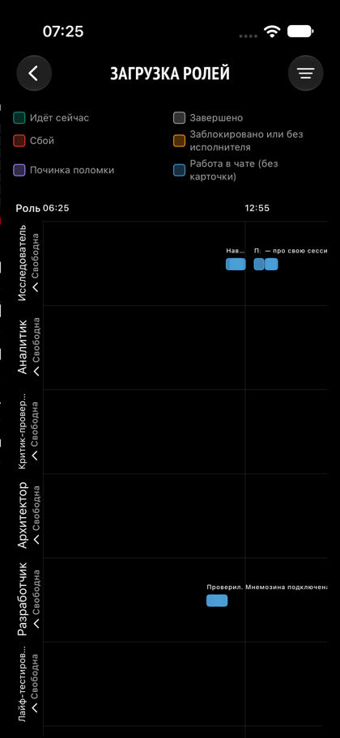

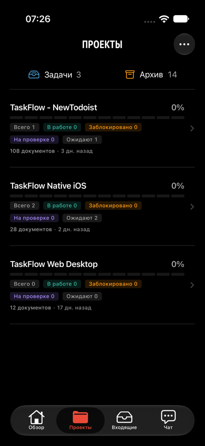

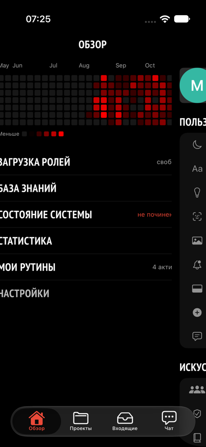

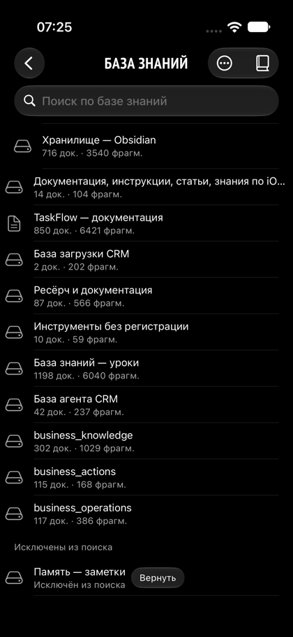

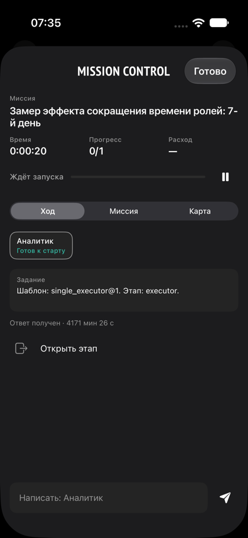

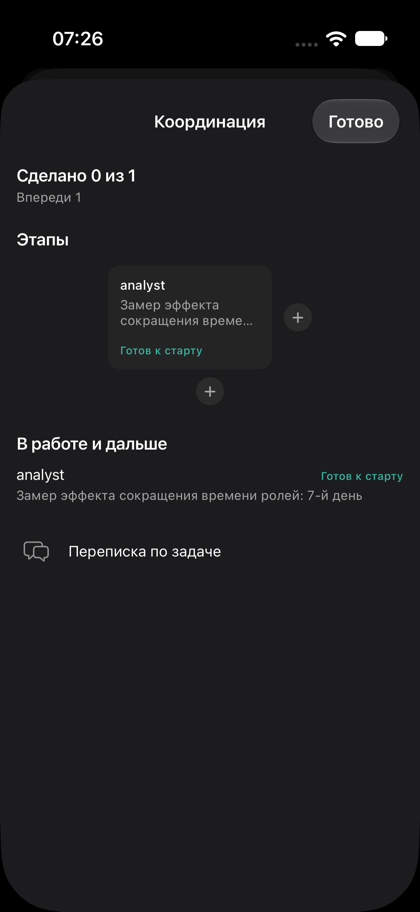

---

## 1. Execution spine

Единица работы — **карточка**. Исполнение — только через **утверждённый план**
(DAG узлов). «Одна роль» = профиль плана `single_executor`, не отдельный
диспетчер мимо плана.

**Кадр:** карточка с утверждённым планом —


**Существительные:**

| Термин          | Смысл сейчас                                                                               |
| --------------- | ------------------------------------------------------------------------------------------ |
| Карточка        | Поручение; закрывает только владелец                                                       |
| План            | Утверждённый DAG в `task_collaboration_plans`                                              |
| Слот / узел     | Обычный `subtask` с `collaboration_plan_id` + `plan_node_key` (+ стабильный `slot_number`) |
| Попытка         | Один заход слота (lease / пульс)                                                           |
| Артефакт        | Версия результата шага; открывает следующие рёбра                                          |
| Квитанция сдачи | Сервер подтвердил сдачу; без неё шаг не «сдан»                                             |
| Очередь в main  | `worktreeMergeQueue` / `acceptedMerge` — без роли интегратора и без PR по умолчанию        |

**Happy path:** вход → подготовка/структура → утверждение плана → слоты по DAG →
попытка роли → сдача (result + receipt) → разблокировка следующих → проверка
если в плане → очередь в main → владелец закрывает карточку.

**Якоря docs:** `docs/current/taskflow-flow.md` (Part II), `submission-receipt.md`,
`plan-artifact-handoff.md`, `plan-role-help.md`, INDEX §«Как принятое попадает в main».

**IN-код (ориентир):** `routes/tasks.ts`, `routes/subtasks.ts`,
`routes/task-collaboration-plans.ts`, `runtime/planSubtaskAdmission.ts`,
`runtime/inProcessRun.ts`, `runtime/worktreeMergeQueue.ts`, `lib/submissionReceipt.ts`.

---

## 2. Mission Control

**Кадр:** 

Не сводить к одной строке «есть контракт».

- Оркестратор пишет **контракт** (`taskflow_mission_contract`) **до** разбиения;
  без покрытия пунктов шаг `orchestrate` не сдаётся.
- Шаг с assertions сдаётся артефактом с `payload.assertions`; Критику пункты
  контракта не назначают — только вердикт.
- **Пауза/resume** плана; поле `paused_at`.
- **Время и расход** по задаче (`missionTime`, `model_usage.task_id` с 05.11).
- **Лента** `GET …/mission-events` → `missionLog`.
- Mission skills/assertions **изолированы** задачей (не протекают в другие карточки).

**Якоря:** INDEX §«Контракт…» и §«Данные Mission Control» (05.11);
iOS `Features/Missions`, graft `mission-contract-assertions`, `overview-missions`.

**IN-код:** `lib/missionContract.ts`, `lib/missionTime.ts`, `lib/missionSkills.ts`,
маршруты coordination / mission-events.

---

## 3. Шаблоны плана

Каталог профилей (`TEMPLATE_PROFILES` в `collaborationTemplates.ts`), среди них:
`single_executor`, `research`, `delivery`, `full_cycle`, `orchestrated`,
`product_feature`, `bug_regression`, `ux_concept`, `api_integration`, `audit`,
`result_review`, `code_review`.

Пакеты инструкций и кандидатов навыков **персистятся в узлах** при создании
плана (`TEMPLATE_VERSION`); начатый план не пересчитывается задним числом.
Рутины выбирают тот же шаблон (`plan_profile` / «Автоматически»).

**Якоря:** `docs/2026-10-18-template-packages.md`,
`docs/2026-10-18-template-server-deploy.md`,
`docs/2026-10-29-routine-template-plan.md`,
`docs/2026-10-22-review-templates.md`.
Папки `docs/2026-09-29-collaboration-plan-templates/` в дереве нет.

**iOS:** шаблон как `CollaborationPlanTemplate` в моделях плана (graft
`collaboration-planning-execution-graph`); рутины — `Features/Routines`.

---

## 4. Окружение роли на карточке

**Кадры:**  

- **Role homes:** `~/taskflow/roles/<key>/` — `AGENTS.md`, skills, scripts,
  workspace, sessions (`docs/current/role-homes.md`).
- **Worktree карточки:** `~/.local/state/taskflow-runs/worktrees/<task_id>`,
  ветка `roles/<task_id>`; роли одной карточки делят дерево (INDEX).
- **Host:** daemon на Mac + sandbox; host-операции ролям через taskflow-инструменты
  (`docs/2026-10-16-host-access-all-roles.md`).
- **Фон:** длинные host-команды вне хода (`docs/2026-11-08-role-background-jobs.md`).
- Снимок матрицы инструментов: `docs/2026-10-20-tool-stack-audit/`.

Чат роли и работа по карточке разделяют cwd: чат → workspace роли; задача →
worktree/проект карточки. Глобальный `~/.pi/agent` чужих ролей не подмешивается.

---

## 5. Коммуникация агентов

**Кадры (UI чата как витрина слоя):**  

Отдельный слой от «UI чата». Инвариант 06.10: **ни один шаг не кончается
молчанием**.

- Каждое завершение шага → типизированный исход (`step_outcome` + закрытый
  словарь причин).
- **Первый получатель — сервер**, не оркестратор: retry / switch_model /
  compress / block по правилам.
- Оркестратору и владельцу — только по лестнице эскалации («меняет результат»
  → владелец).
- Мессенджер ролей (`taskflow_chat_*`), токен молчания вместо пустого «принял».
- `request_help` / правки плана → `proposed` и approve владельца где нужно
  (`coordination-owner-approval`, `plan-role-help`).

**Якоря:** `docs/2026-10-06-agent-communication-plan.md`,
`docs/2026-10-06-agent-communication-project-summary.md`,
`docs/2026-10-12-agent-messaging.md`,
`docs/2026-10-04-chat-coordination.md`,
`docs/current/coordination-owner-approval.md`,
`docs/current/plan-role-help.md`.

**IN-код:** `runtime/stepOutcome.ts`, `failureReasons.ts`, `failurePolicy.ts`,
`blockSignals.ts`, `agentMessaging.ts`, `stalledStepWatcher`.

---

## 6. Топология чатов (on-card / off-card)

**Кадры:**   

### Правило режима (INDEX 05.11)

- Чат с `chats.task_id` → **только по карточке**.
- Любой другой чат (личный и пр.) → **только чат**.
- Способ работы не выбирается моделью в сообщении.

### On-card

- Одна комната задачи (`room_kind='task'`), без обязательного проектного чата
  (`docs/2026-11-08-task-rooms-without-project.md`).
- Участник исполнения адресуется **слотом** со стабильным номером
  (`docs/2026-11-08-slot-numbers.md`).
- Передача работы: итог слота + сжатый digest, не сырой лог
  (`slot-handoff.md`, `slot-handoff-digest.md`).
- Заблокированный слот: маячок ```plan → «Продолжить» → рабочий запуск.
- В личных комнатах та же комната видна топиком — представления, не копии.

### Off-card

- Личная комната роли = родитель; дочерние сессии: личная ветка или assignment
  слота (`docs/2026-11-08-role-slot-chat-branches-spec.md`,
  `chat-child-sessions.md`).
- Карточки координации / system / memory chips **не** в историю модели
  (`history-isolation.md`).
- Субагент — одноразовая комната-ветка (INDEX).

**iOS:** `Sources/Chat`, `TaskChatSheet`, `Features/Coordination` (граф + поток),
graft `role-chat-system`, `chat-work-plan-display`, `coordination-workflow-engine`.

**IN-код:** `routes/chats.ts`, `lib/slotHandoff.ts`, `lib/chatHistoryModel.ts`,
`runtime/slotConversation.ts`, `chat_child_sessions` / task room миграции.

---

## 7. Спутники (кратко)

| Спутник                | Зачем                                                    | Якоря                                                   |
| ---------------------- | -------------------------------------------------------- | ------------------------------------------------------- |
| Память                 | Банки Mnemosyne; в работу — через recall, не авто-впрыск | INDEX 05.11; `docs/2026-11-08-memory-mnemosyne.md`      |
| Knowledge / library    | Документы, датасеты, vault                               | `taskflow-library-vault.md`; knowledge commits 09–10.11 |
| Secret / egress broker | Модели и OAuth через broker; research egress отдельно    | `docs/2026-11-09-*-broker-*.md`                         |
| Внешние MCP / Composio | Ops роли                                                 | INDEX §инструменты                                      |
| Watchers               | Приборы → карточки                                       | INDEX §приборы                                          |

---

## 8. OUT / superseded (кандидаты на откладку, не на удаление)

Когда дойдём до срезки — **перенос в архив / отдельную ветку / `_parked/`**,
с указателем «как вернуть», а не `rm -rf`.

| Что                                                                 | Статус          | Чем заменено                             |
| ------------------------------------------------------------------- | --------------- | ---------------------------------------- |
| Inbox / Today / Labels как продукт                                  | OUT продукта    | Карточка + Mission + Coordination + чаты |
| `dispatchTaskToPi` / dual-path                                      | OUT             | План, в т.ч. `single_executor`           |
| Таблица / API `task_role_slots`                                     | OUT (уже drop)  | Слот = subtask + plan node               |
| `ready_for_pickup` как гейт claim                                   | residue         | Не ось допуска                           |
| Роль/шаг «Интеграция» + PR-as-default                               | OUT (05.11)     | Merge queue → main                       |
| Проектные чаты как иерархия                                         | OUT (08.11)     | Комната задачи                           |
| Авто-впрыск Mnemosyne в контекст работы                             | OUT (05.11)     | `recall`                                 |
| `roles.prompt` / `role-prompts/`                                    | OUT (20.10)     | AGENTS.md + SYSTEM.md                    |
| Активная разработка веб-клиента                                     | заморозка 24.10 | iOS                                      |
| Сырой handoff из 20 сообщений                                       | superseded      | handoff + digest                         |
| Нумерация слота «по position»                                       | superseded      | `slot_number`                            |
| Часть `taskflow-flow.md` Part I dual-scheme и §12 «автослияния нет» | устарело        | этот CANON + INDEX 05.11                 |
| `integration-owner.md` как путь merge                               | superseded      | merge queue                              |

На iOS при срезке ориентироваться на те же OUT: экраны/ветки под Inbox/Today/
Labels/проектные чаты — кандидаты на откладку вместе с серверными хвостами,
после явного ОК; живые якоря — Tasks/Detail, Missions, Coordination, Chat, Roles.

---

## Чеклист следующего этапа (срезка — отдельно)

1. Пройти IN-модули сервера по §§1–6 и пометить файлы вне контура.
2. Пройти iOS `Features/*` тем же списком слоёв.
3. Всё OUT — в архив с README «откуда вырезали / как вернуть».
4. Не начинать срезку, пока владелец не утвердил этот CANON.

---

_Собран 10.11.2026 из INDEX, docs Oct–Nov, graft сервера и ориентиров
TaskFlowNativeBuild. Не заменяет узкие доки — указывает на них._
